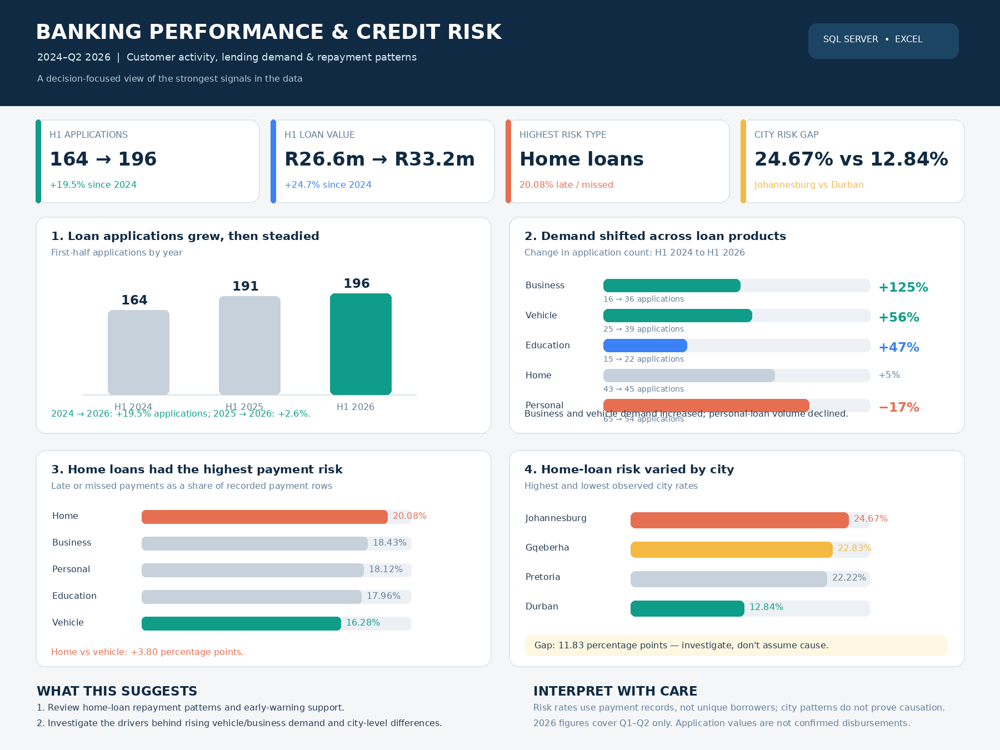

# Banking Credit Risk Analysis (2024–2026)

**Tools:** SQL Server, SSMS, Microsoft Excel  
**Focus:** Banking analytics, lending performance, repayment risk, and business insights

## Executive Summary

This project explores banking customer activity, account balances, lending trends, loan approvals, and repayment behaviour using SQL Server and Excel.

Rather than only reporting totals, I used investigative SQL queries to explore differences across loan types, application periods, and cities. The findings highlight areas worth investigating further, particularly home-loan repayment risk and changes in lending demand.

## Business Problem

Banks need to understand customer activity, identify lending opportunities, and monitor repayment risks. This project investigates where lending patterns and repayment outcomes differ, helping turn raw banking data into practical business recommendations.

## Key Questions

- Which banking channels and account types show the strongest activity?
- How has loan application demand changed over time and across loan types?
- Which loan types have higher approval and repayment-risk rates?
- Do repayment-risk patterns differ by city or customer employment status?

## Technical Approach

I used SQL Server and SSMS to analyse five related tables: `Customers`, `Accounts`, `Transactions`, `Loans`, and `LoanPayments`.

Key techniques included:
- **Data quality checks** to identify and address duplicate transaction records.
- **JOINs and aggregations** to combine related tables and calculate business metrics.
- **CASE expressions and conditional aggregation** to compare loan statuses and repayment outcomes.
- **Date-based analysis** to investigate quarterly application trends.
- **Follow-up investigative queries** to explore differences by loan type, city, and employment status.
- **Excel** to present findings in a dashboard and communicate the results in a business report.

## Key Findings and Recommendations

### 1. Digital banking showed strong transaction activity
The Mobile App recorded approximately **R6.6 million** in transaction value, compared with **R4.7 million** through Online Banking.

**Recommendation:** Investigate which services drive mobile activity and whether improvements to digital banking could encourage further adoption and reduce reliance on branch-based transactions.

### 2. Lending demand differed by loan type
Personal loans had the highest overall recorded loan value at approximately **R51.3 million**. In the first half of each year, vehicle-loan applications increased from **25 in 2024 to 39 in 2026**, while personal-loan applications declined from **65 to 54**.

**Recommendation:** Monitor these changing patterns when reviewing lending demand and planning product-specific campaigns.

### 3. Approval rates varied across loan types
Vehicle loans had the highest overall approval rate at **73.42%**, while business loans had the lowest at **59.21%**.

Business-loan approval rates increased from **56.25% in H1 2024 to 63.89% in H1 2026**.

**Recommendation:** Investigate the factors associated with approval differences, including application quality and eligibility criteria, before making changes to lending policies.

### 4. Home loans showed the highest repayment-risk rate
Approximately **20.08%** of recorded home-loan payment records were late or missed, compared with **16.28%** for vehicle loans.

**Recommendation:** Review home-loan repayment patterns and consider early-warning monitoring to identify accounts that may need support.

### 5. Repayment risk differed by city
Among the cities analysed, Johannesburg had the highest home-loan payment-risk rate at **24.67%**, while Durban had the lowest at **12.84%**.

**Recommendation:** Investigate the geographic differences further before targeting interventions. The analysis identifies a pattern but does not establish its cause.

## Business Value

This project demonstrates how SQL can be used to move from descriptive reporting to targeted investigation. It connects operational metrics to questions about lending demand, approval outcomes, and repayment risk, then translates supported findings into practical next steps.

## Dashboard Preview

## Limitations

- Repayment-risk percentages are based on payment records, not unique borrowers.
- Geographic differences do not establish the reasons behind repayment outcomes.
- Loan application values should not automatically be interpreted as approved or disbursed amounts.
- Some customer groups have small sample sizes, limiting reliable comparisons.

## Conclusion

This project strengthened my ability to use SQL for relational data analysis, investigate patterns through follow-up queries, and communicate findings in a business-focused way. It reflects my approach to analytics: **identify a pattern, investigate what the data can support, and recommend a sensible next step without overstating the evidence.**
